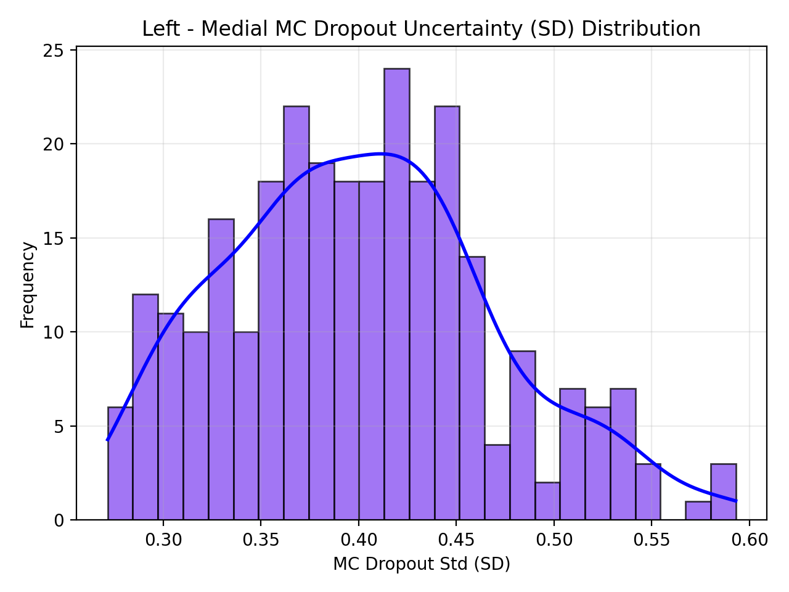
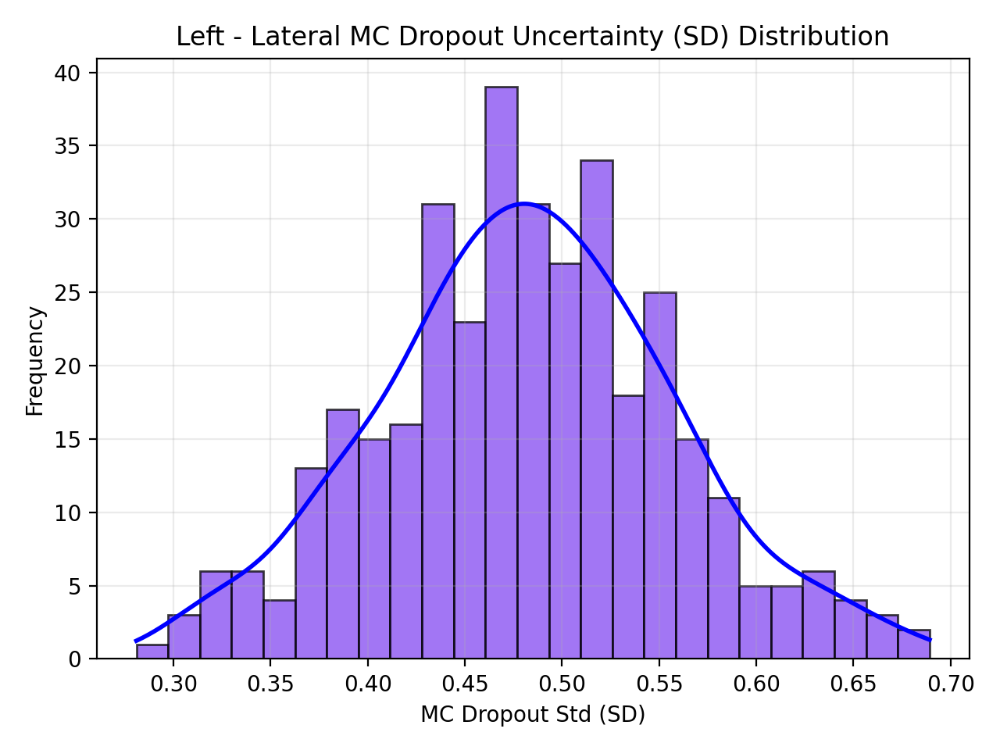
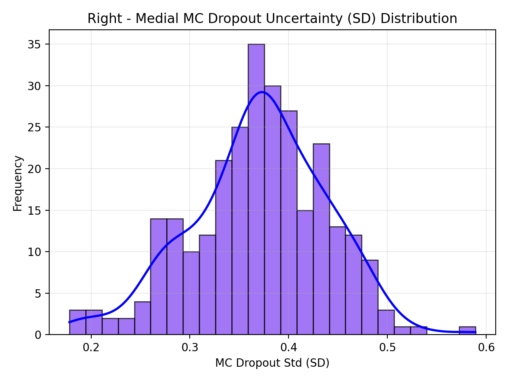
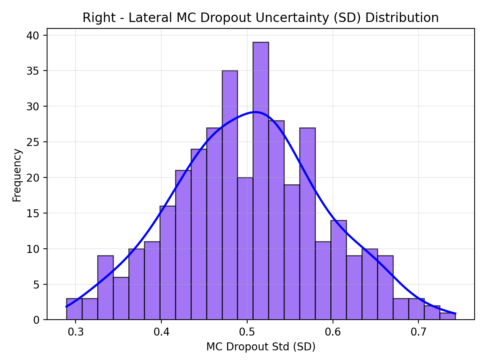

# JSW Regression, Uncertainty (MC Dropout)

This section reports the <strong>uncertainty quantification</strong> results for the <strong>ResNet-50 JSW regression</strong> models using <strong>Monte Carlo Dropout (MC Dropout)</strong>.
The goal is to estimate the predictive variability by performing multiple stochastic forward passes at inference time.

## Method

We keep the network in evaluation mode while enabling Dropout layers only, and we run T stochastic forward passes per image.
For each output target, we compute:
<strong>Mean (μ)</strong>,
<strong>Standard Deviation (SD)</strong> as an uncertainty proxy, and
<strong>90% predictive interval</strong> using Q05–Q95.

## Results (T = 50)

The table below summarizes the uncertainty-aware evaluation on the test split.
<strong>Coverage90</strong> indicates the fraction of ground-truth values lying within the predicted <strong>Q05–Q95</strong> interval.

<table>
  <thead>
    <tr>
      <th>Side</th>
      <th>MAE (Medial)</th>
      <th>MAE (Lateral)</th>
      <th>Coverage90 (Medial)</th>
      <th>Coverage90 (Lateral)</th>
    </tr>
  </thead>
  <tbody>
    <tr>
      <td>Left</td>
      <td>0.5200</td>
      <td>0.7732</td>
      <td>0.6643</td>
      <td>0.5817</td>
    </tr>
    <tr>
      <td>Right</td>
      <td>0.6265</td>
      <td>0.9020</td>
      <td>0.6000</td>
      <td>0.4883</td>
    </tr>
  </tbody>
</table>

## Uncertainty Plots (SD Histograms)

<table align="center">
  <tr>
    <td align="center">
      <strong>Left – Medial</strong> 
      
    </td>
    <td align="center">
      <strong>Left – Lateral</strong> 
      
    </td>
  </tr>
  <tr>
    <td align="center">
      <strong>Right – Medial</strong> 
      
    </td>
    <td align="center">
      <strong>Right – Lateral</strong> 
      
    </td>
  </tr>
</table>
